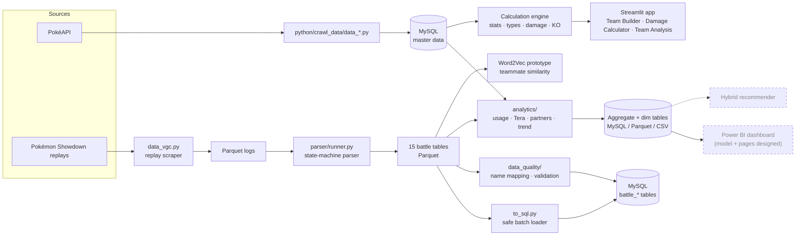

# Pokémon Competitive Analytics (VGC)

[](https://github.com/hoangphuc082602/Pokemon-Competitive-Analysis/actions/workflows/CI.yml)


An end-to-end data project built around **Pokémon VGC** (Level 50 doubles battles). Instead of analysing a ready-made dataset, it covers the whole data lifecycle:

> collect → normalise → model → parse / ETL → store (Parquet + MySQL) → validate → aggregate → analyse → recommend

It combines a **battle-log parsing pipeline** (3.6M Pokémon Showdown replays), a **data-quality layer** (name mapping, validation, safe loading), **metric definitions with explicit denominators**, a **rules-accurate calculation engine** (stats, type effectiveness, damage, KO chances) and a **Streamlit app** for building and analysing teams.

## Highlights

- **Real-scale data.** 3.64M parsed replays (2.55M of them VGC, Regulation D 2023 → Champions Reg M-A 2026) and 82M move events, parsed in under an hour and resumable after a crash.
- **Hand-written state-machine parser.** Turns raw Showdown logs into 15 relational tables, streaming to Parquet in batches so memory stays flat. Uses the replay id as `battle_id`, records the real species / form of every event (not the player's nickname) and resolves the forms Showdown hides at team preview.
- **Data quality as a first-class concern.** Findings that changed the design are documented below, e.g. hashing the log head as an id silently dropped 2.4% of battles; reading the avatar id as a rating corrupted 163k ratings.
- **Metrics with denominators.** [`METRICS.md`](METRICS.md) defines scope, population and formulas; every aggregate row carries its sample size and a Wilson interval. Aggregates cover usage, win rate, rating bands, Tera, teammate lift and monthly trends.
- **Calculation engine with ability interactions.** Level 50 stats (IV / EV / Nature), STAB (including ability-converted move types), type chart with ability immunities / resistances, damage rolls and OHKO / 2HKO probabilities.
- **Tested.** The suite runs without a database: parser regression logs, the Parquet → MySQL loader (against SQLite), name mapping, aggregation, and the calculation core.

## Scale

The figures below come from the author's local MySQL instance. **The datasets are not stored in this repository**; they are rebuilt with the pipeline described in [Getting started](#getting-started).

| Battle data (Showdown replays) | Rows | Master data (PokéAPI) | Rows |
|---|---:|---|---:|
| `battle` | 3,642,499 | `pokemon_species` | 1,025 |
| `battle_team_slot` | 43,537,949 | `moves` | 919 |
| `battle_move` | 82,621,051 | `ability` | 311 |
| `battle_damage` | 74,061,318 | `item` | 2,120 |
| `battle_field_state` | 28,236,595 | `pokemon_moves` (learnsets) | 45,969 |
| `battle_switch` | 24,039,407 | `type_effectiveness` | 120 |
| `battle_faint` | 19,998,380 | `pokemon_stats` | 1,350 |

About 30% of the crawled replays are not VGC (Doubles OU, National Dex Doubles, 2v2 Doubles). They stay in the database but are excluded from every VGC statistic through the `vgc_battles` scope table.

## Architecture



Dashed boxes are planned, not built yet. Game mechanics (PokéAPI, deterministic rules) and competitive statistics (Showdown, empirical observations) are kept separate on purpose: a Pokémon being popular does not mean it is mechanically stronger.

## Project status

| Area | Status | Notes |
|---|---|---|
| PokéAPI crawlers → MySQL master data | Done | 16 scripts, each writes a CSV and loads one table |
| Showdown replay scraper | Done | 20 VGC formats; requires `poke-env` |
| Battle-log parser (15 tables, Parquet) | Done | v2: replay-id `battle_id`, species per event, observed forms, one row per player |
| Parquet → MySQL loader (`to_sql`) | Done | Row-group transactions, refuses non-empty tables, `--resume` after an interruption |
| Showdown → PokéAPI name mapping | Done | 97.5% exact form, 2.5% species-only (masked or missing from the master data) |
| Metric definitions and VGC scope | Done | [`METRICS.md`](METRICS.md), `migrations/002_vgc_battles.sql` |
| Aggregates: usage, win rate, leads, rating bands | Done | `pokemon_usage`; 95% Wilson intervals, band baselines |
| Aggregates: Tera, partners / lift, monthly trend | Done | `tera_stats`, `partner_stats`, `usage_trend`; tail months flagged |
| Dimension tables for BI | Done | `dim_tables`: regulation, rating band, month, species |
| Calculation engine | Core done | See [limitations](#known-limitations) |
| Streamlit app | Prototype | Team Builder, Damage Calculator, Team Analysis |
| Unit tests | Passing in CI | No database needed |
| Matchup aggregate | Done | `matchup_stats`: team level, log5 expectation |
| EDA report | Done | `eda_report` generates `docs/EDA_FINDINGS.md` and charts |
| Power BI dashboard | Designed | [`docs/POWERBI_PLAN.md`](docs/POWERBI_PLAN.md): data model, pages, measures |
| Recommendation | Prototype | Word2Vec teammate similarity, not evaluated |

## Tech stack

Python · pandas · NumPy · PyArrow / Parquet · SQLAlchemy + PyMySQL · MySQL · Streamlit · Gensim (Word2Vec) · pytest · GitHub Actions. Power BI is planned for the dashboard layer.

## Repository layout

```text
.
├── python/
│   ├── crawl_data/        # PokéAPI crawlers (data_*.py) and the replay scraper (data_vgc.py)
│   ├── calculations/      # stats, nature, type chart, damage, KO %, speed, roles, team validation
│   ├── database/          # db_connection.py (reads .env), table loaders, to_sql.py (Parquet -> MySQL)
│   ├── data_quality/      # name mapping, masked-form diagnostics, id and output validators
│   ├── analytics/         # aggregates (usage, Tera, partners, trend), dimension tables, MySQL writer
│   ├── models/            # build_pokemon(): final stats from species + nature + EV / IV
│   ├── services/          # team persistence (save / load teams)
│   ├── recommendation/    # rule-based role recommender (early prototype)
│   ├── ml/                # team feature helpers
│   ├── untils/            # shared constants
│   └── test/              # pytest suite
├── parser/                # battle-log state machine and the batch runner
├── migrations/            # SQL run by hand: species / username columns, VGC scope table, optional raw-table indexes
├── docs/                  # Power BI plan
├── src/                   # Word2Vec prototype (team generator, training, similarity query)
├── streamlit_app/         # app.py and pages/
├── models/                # trained Word2Vec model
├── Schema.py              # prints row counts and columns of every table (used to produce schema.sql)
├── schema.sql             # table / column overview of the MySQL schema (metadata, not executable DDL)
├── METRICS.md             # scope, populations and metric definitions
├── requirements.txt       # runtime dependencies
└── requirements-dev.txt   # + pytest
```

## Getting started

### 1. Install and run the tests (no database needed)

```bash
git clone https://github.com/hoangphuc082602/Pokemon-Competitive-Analysis.git
cd Pokemon-Competitive-Analysis

python -m venv venv
# Windows: venv\Scripts\activate      macOS / Linux: source venv/bin/activate
pip install -r requirements-dev.txt

pytest
```

### 2. Configure the database

Create an empty MySQL database (default name `pokemon_analytics`), then copy the example environment file and edit it:

```bash
cp .env.example .env
```

| Variable | Default | Meaning |
|---|---|---|
| `DB_HOST` | `localhost` | MySQL host |
| `DB_PORT` | `3306` | MySQL port |
| `DB_USER` | `root` | MySQL user |
| `DB_PASSWORD` | – | MySQL password |
| `DB_NAME` | `pokemon_analytics` | Database name |

`.env` is git-ignored. No credentials live in the code.

### 3. Build the master data

Each script downloads one PokéAPI entity, writes `data/raw/<name>.csv` and loads the matching MySQL table. Run them from the repository root:

```bash
python -m python.crawl_data.data_type
python -m python.crawl_data.data_pokemon
# ... one script per entity in python/crawl_data/
```

### 4. Run the app

```bash
streamlit run streamlit_app/app.py
```

The app reads the master data from MySQL, so step 3 must be done first.

### 5. Battle-log pipeline (optional)

```bash
pip install poke-env                                  # only needed for the replay scraper
python -m python.crawl_data.data_vgc --num_workers 4  # scrape replay logs -> data/vgc_data/*.parquet

# parse: the replay id becomes battle_id
python parser/runner.py --data-dir data/vgc_data --out-dir data/output --workers 4 --id-col id
python parser/runner.py --data-dir data/vgc_data --out-dir data/output --workers 4 --id-col id --resume   # continue after a crash
python parser/runner.py --help                        # all options (--chunk-rows, --batch, --limit-rows, --dry-run ...)
```

Memory stays flat: logs are read in chunks (`--chunk-rows`) and only a few tasks are in flight. Each source file is written to `data/output/parts/<file>/` and marked `_DONE`, so a crash only loses the file being processed; when all files are done the parts are merged into one `<table>.parquet` per table (the `parts/` folder can then be deleted). A full run (3.6M battles) takes under an hour on the author's machine.

### 6. Load Parquet into MySQL

The target tables must exist (`schema.sql` lists their columns). Run `migrations/001_add_species_columns.sql` and `003_add_username_to_event_tables.sql` once on the empty tables, then:

```bash
python -m python.database.to_sql --output-dir data/output --dry-run   # plan only
python -m python.database.to_sql --output-dir data/output             # load every table found
python -m python.database.to_sql --output-dir data/output --tables battle_team_slot --resume   # continue after an interruption
```

The loader checks that Parquet and table columns match, refuses to load into a non-empty table (so a repeated run cannot duplicate rows) and commits one row group at a time. `--resume` continues from the first row group not yet loaded and refuses when the table is not a clean prefix. Other options: `--tables`, `--batch-size`, `--truncate`, `--allow-non-empty`.

### 7. Data-quality tools

Showdown names differ from PokéAPI names (`Indeedee-F`, `Tornadus`, ...). The mapper links them using exact matches and an explicit override file; forms it cannot place are never merged into another form.

```bash
python -m python.data_quality.pokemon_name_mapping --team-slot data/output/battle_team_slot.parquet \
       --species-dir data/output --to-mysql               # report in data/mapping/, writes showdown_pokemon_map
python -m python.data_quality.validate_v2_output --out-dir data/output
python -m python.data_quality.check_battle_ids            # replay ids vs log hashes in the raw crawl
```

Fix unmatched names by adding rows (`showdown_name,pokemon`) to `python/data_quality/showdown_overrides.csv`. Fan-made (CAP) Pokémon are listed in `showdown_non_canonical.csv` and ignored.

How forms are treated (`form_status` in `showdown_pokemon_map`):

| Status | Meaning |
|---|---|
| `known` | exact form found in the master data |
| `masked` | Showdown hides the form at team preview (`Urshifu-*`): species only; the real form is read from the battle when the Pokémon entered the field |
| `unlisted` | form missing from the master data (`Arceus-Fire`, `Ogerpon-Wellspring-Tera`): species only |

### 8. Aggregates

Run `migrations/002_vgc_battles.sql` for the scope table, then (each command reads the parser output and writes Parquet + CSV to `data/aggregates/`; add `--to-mysql` to also write indexed MySQL tables):

```bash
python -m python.analytics.pokemon_usage --output-dir data/output --show gen9vgc2025regi    # usage, win rate, sent-out, leads, rating bands
python -m python.analytics.tera_stats --output-dir data/output                              # Tera rate, Tera types, win rate with / without Tera
python -m python.analytics.partner_stats --output-dir data/output --partners Incineroar      # teammate co-occurrence and lift
python -m python.analytics.usage_trend --output-dir data/output --species Incineroar         # monthly usage per regulation
python -m python.analytics.matchup_stats --output-dir data/output --species Incineroar       # team-level matchups (A's team vs B's team)
python -m python.analytics.eda_report --agg data/aggregates --out docs                      # EDA findings and charts -> docs/EDA_FINDINGS.md
python -m python.analytics.dim_tables --output-dir data/output                               # regulation / rating band / month / species dimensions
```

`pokemon_usage` must run before `tera_stats` (it reads its output for the denominators). Each script prints sanity checks before the results (average team size close to 6, win rate over all slots close to 50%, at most 4 Pokémon sent out per team, pairs per team close to 15) and the figures are cross-checked between modules.

| Table | Grain |
|---|---|
| `pokemon_usage_stats`, `regulation_totals` | regulation × rating band × species × form |
| `pokemon_tera_summary`, `pokemon_tera_types` | regulation × rating band × species (× Tera type) |
| `pokemon_partner_stats` | regulation × rating band × species pair |
| `pokemon_usage_monthly`, `regulation_monthly_totals` | regulation × month × species |
| `pokemon_matchup_stats` | regulation × rating band × ordered species pair |
| `dim_regulation`, `dim_rating_band`, `dim_month`, `dim_species` | labels and sort orders for the BI layer |

Rating bands are per player (`below_1200`, `1200_1399`, `1400_1499`, `1500_plus`, `unknown`, plus `all`). Months far below the busiest month of a regulation are flagged `tail` (the format is ending, a different population) and excluded from charts. [`METRICS.md`](METRICS.md) has the exact definitions.

Example (author's data, Regulation I 2025, 991,234 player-battles; usage = share of teams containing the species):

| Species | Teams | Usage | Win rate |
|---|---:|---:|---:|
| Calyrex | 484,021 | 48.8% | 51.3% |
| Incineroar | 355,342 | 35.8% | 50.1% |
| Miraidon | 311,631 | 31.4% | 51.0% |
| Urshifu | 287,064 | 29.0% | 51.0% |

Win rates this close to 50% are expected for a large ladder population; always read them with the sample size and interval stored in the table, and within a rating band compare with the band's own baseline (`win_rate_delta`), because the opponents of a high-rated player are on average lower rated.

## Testing

```bash
pytest
```

The suite needs neither MySQL nor network access:

- stat and Nature formulas against reference Level 50 values
- type chart and ability interactions (immunities, resistances, Scrappy, Mold Breaker, `-ate` and Normalize)
- damage, STAB and KO probability, with the damage roll fixed so tests are repeatable
- team defensive / offensive coverage, role labelling and team validation (duplicate Pokémon / items, illegal moves)
- the battle-log parser on synthetic logs (nicknames, hidden forms, Mega Evolution, repeated `|player|` lines, turn-0 replacements) and the batch runner (serial vs parallel, replay ids, source metadata)
- the Parquet → MySQL loader (against SQLite, including `--resume`), the name mapper, every aggregate (usage, Tera, partners, trend, dimensions) and the indexed table writer

## Known limitations

These are tracked openly rather than hidden:

- **Damage calculator** does not model spread moves, critical hits, weather, burn, item and ability damage modifiers, Tera STAB or stat stages yet. Wind Rider's immunity to wind moves is not modelled either (it needs a list of wind moves).
- **Player table.** `players` has one row per player-battle; a deduplicated players table does not exist yet, so per-player statistics are not available.
- **Forms.** Nine species are masked at team preview; their form is known only for Pokémon that entered the field, and the rest stay `unobserved`. Form-level statistics for them use the sent-out population. See [`METRICS.md`](METRICS.md).
- **Ratings.** `rating_before` is `NULL` for part of the data; rating-filtered metrics must report the excluded share.
- **Attribution.** Attacker attribution for damage / KO events is heuristic.
- **Sample.** Public Showdown replays are a self-selected sample of ladder games, not tournament play, and games of a best-of-three set are not independent.
- **Aggregates.** Matchups are team-level (the species' team against the opposing team), not on-field. Win rates with and without Tera are not comparable (a Pokémon must be alive to Terastallize), lift is co-occurrence not synergy, and the month is the upload month of the replay.
- **Illusion.** The log shows Zoroark's disguise until it breaks, so sent-out counts of Zoroark and of the impersonated Pokémon can be off by a few games.
- **Recommendation** is a Word2Vec baseline (128 dimensions, skip-gram, `min_count=100`) with no evaluation. It is not a production recommender.

## Roadmap

1. Publish the EDA findings (`docs/EDA_FINDINGS.md`).
2. The Power BI dashboard on the aggregates (model and pages are designed in [`docs/POWERBI_PLAN.md`](docs/POWERBI_PLAN.md)).
3. Damage-calculator mechanics and a service layer between Streamlit and the calculation engine.
4. Hybrid recommendation: rule-based gaps (role, coverage, speed) + meta statistics + embeddings, evaluated on hold-out battles.
5. Longer term: FastAPI service, speed calculator, EV / IV optimiser, Smogon data.

## Data sources and acknowledgements

- [PokéAPI](https://pokeapi.co/) – canonical Pokémon / move / ability / item data.
- [Pokémon Showdown](https://pokemonshowdown.com/) – public battle replays.
- The replay scraper module follows the log-scraping approach of VGC-Bench (see the header of `python/crawl_data/data_vgc.py`) and uses [poke-env](https://github.com/hsahovic/poke-env).
- Word2Vec via [Gensim](https://radimrehurek.com/gensim/).

Pokémon and Pokémon character names are trademarks of Nintendo, Creatures Inc. and GAME FREAK inc. This is a non-commercial educational project and is not affiliated with or endorsed by them.

## Author

**Hoàng Phúc** – [github.com/hoangphuc082602](https://github.com/hoangphuc082602)