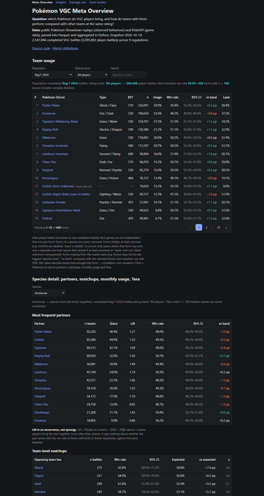
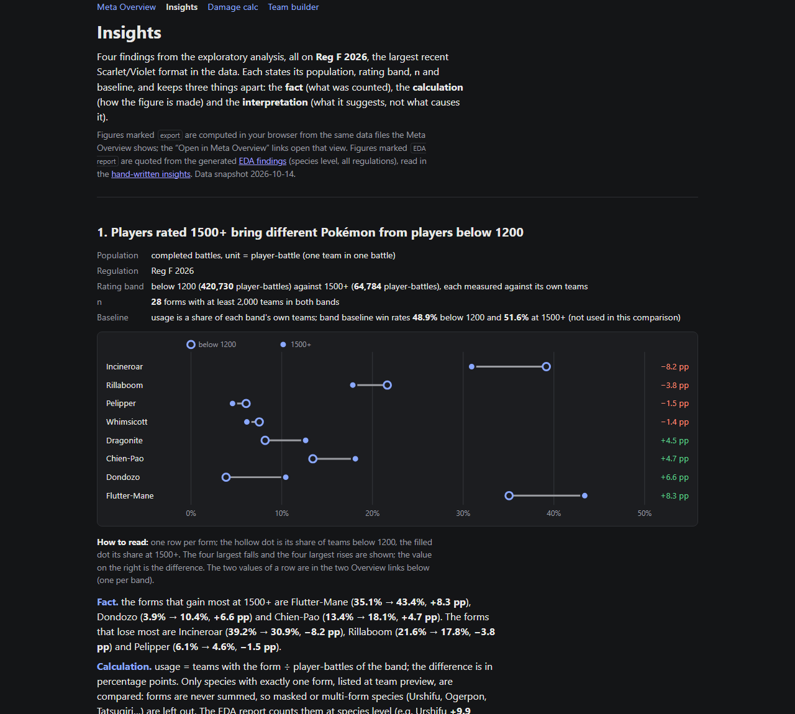
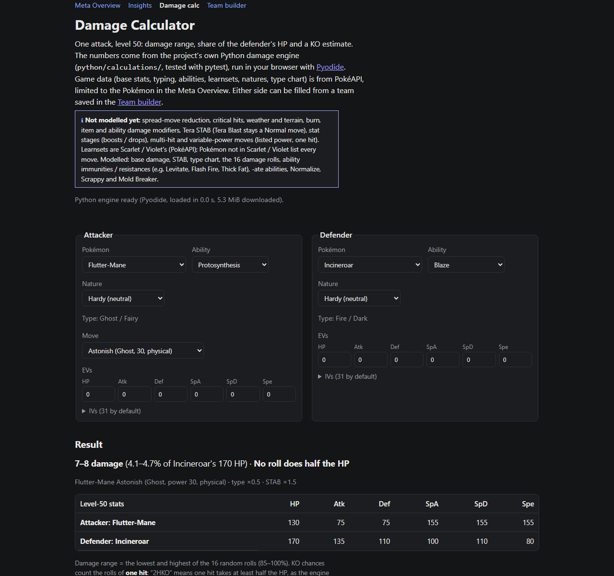
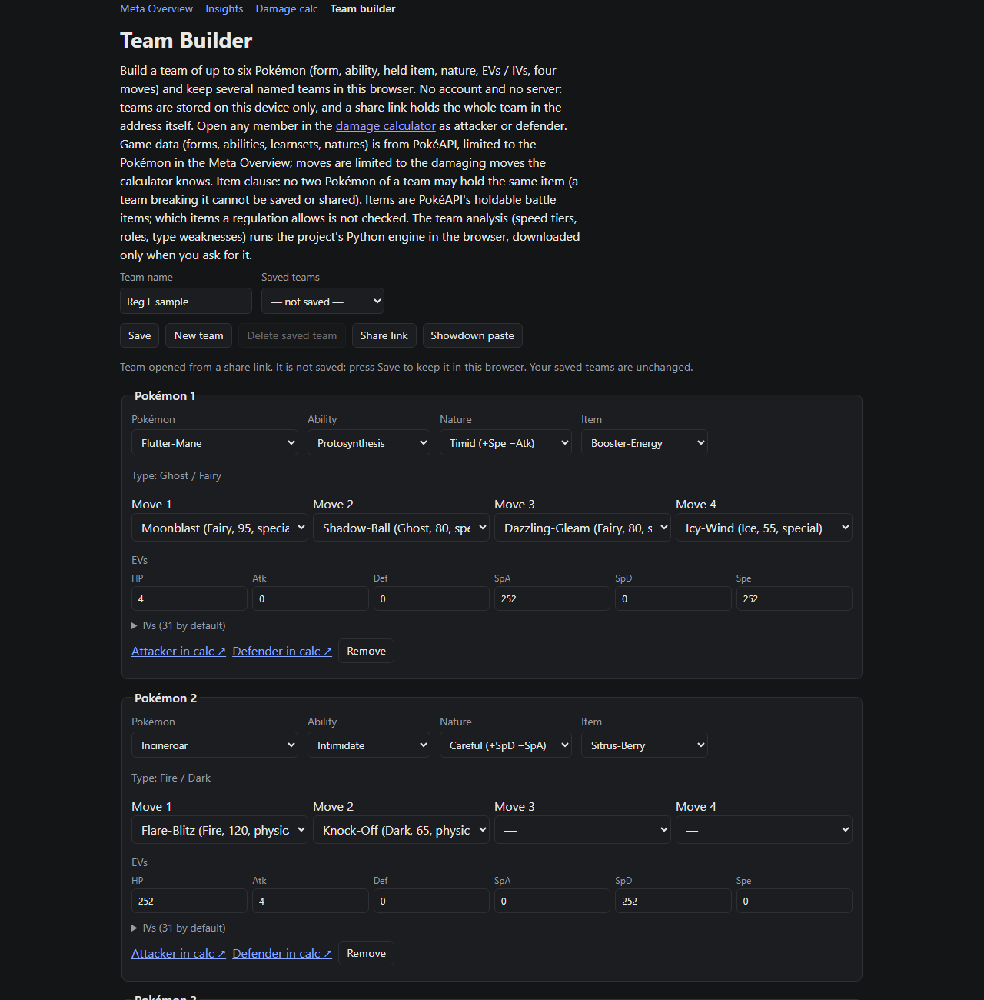
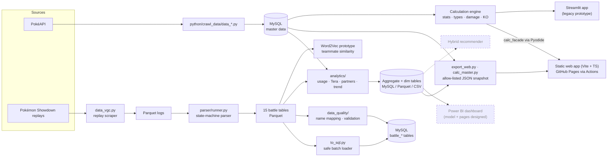

# Pokémon Competitive Analytics (VGC)

[](https://github.com/hoangphuc082602/Pokemon-Competitive-Analysis/actions/workflows/CI.yml)


**Live demo: <https://hoangphuc082602.github.io/Pokemon-Competitive-Analysis/>** — Meta Overview · Insights · Damage Calculator · Team Builder. No install, no account.

An end-to-end data project built around **Pokémon VGC** (Level 50 doubles battles). Instead of analysing a ready-made dataset, it covers the whole data lifecycle:

> collect → normalise → model → parse / ETL → store (Parquet + MySQL) → validate → aggregate → analyse → publish

It combines a **battle-log parsing pipeline** (3.6M Pokémon Showdown replays), a **data-quality layer** (name mapping, validation, safe loading), **metric definitions with explicit denominators**, a **rules-accurate calculation engine** (stats, type effectiveness, damage, KO chances) and a **static web app on GitHub Pages** that publishes the aggregates and runs the Python engine in the browser.

## The web app

The site reads a frozen data snapshot (2026-10-14: 2,547,946 completed VGC battles, 9 regulations from Reg D 2023 to Champions Reg M-A 2026). Every figure shows its population, regulation, rating band and `n`; rows with `n < 100` are hidden.

| Meta Overview | Insights |
|---|---|
| [](https://hoangphuc082602.github.io/Pokemon-Competitive-Analysis/?reg=gen9vgc2024regf&band=all&sp=727) | [](https://hoangphuc082602.github.io/Pokemon-Competitive-Analysis/insights.html) |
| Team usage per regulation × rating band (win rate vs the band's own baseline, 95% Wilson interval, lead rate); per species: partners with lift, team-level matchups against the log5 expectation, monthly trend, Tera. | Four findings on Reg F 2026, each separating fact, calculation and interpretation, with a link to the Overview view that reproduces it. |
| **Damage Calculator** | **Team Builder** |
| [](https://hoangphuc082602.github.io/Pokemon-Competitive-Analysis/calc.html) | [](https://hoangphuc082602.github.io/Pokemon-Competitive-Analysis/team.html) |
| The project's Python damage engine running in the browser via Pyodide (≈ 5.6 MB on first use); a banner lists the mechanics not modelled. | Teams saved in the browser and shared as a link; team analysis (speed tiers, roles, weakness table) and Showdown paste export. |

Screenshots were taken from the live site on 2026-11-24.

## Highlights

- **Real-scale data.** 3.64M parsed replays (2.55M of them VGC, Regulation D 2023 → Champions Reg M-A 2026) and 82M move events, parsed in under an hour and resumable after a crash.
- **Hand-written state-machine parser.** Turns raw Showdown logs into 15 relational tables, streaming to Parquet in batches so memory stays flat. Uses the replay id as `battle_id`, records the real species / form of every event (not the player's nickname) and resolves the forms Showdown hides at team preview.
- **Data quality as a first-class concern.** Findings that changed the design are documented below, e.g. hashing the log head as an id silently dropped 2.4% of battles; reading the avatar id as a rating corrupted 163k ratings.
- **Metrics with denominators.** [`Metrics.md`](Metrics.md) defines scope, population and formulas; every aggregate row carries its sample size and a Wilson interval. Aggregates cover usage, win rate, rating bands, Tera, teammate lift and monthly trends.
- **Calculation engine with ability interactions.** Level 50 stats (IV / EV / Nature), STAB (including ability-converted move types), type chart with ability immunities / resistances, damage rolls and OHKO / 2HKO probabilities.
- **One engine, two runtimes.** The browser calls the same Python modules through a small standard-library façade (Pyodide), so the calculator logic exists only once and is tested in pytest.
- **Business rules at export time.** A Python export turns the aggregates into small JSON files with an allow-list of columns; usernames, replay ids and player-level fields make it fail. The browser only displays.
- **Tested.** The suite runs without a database: parser regression logs, the Parquet → MySQL loader (against SQLite), name mapping, aggregation, the web export and the calculation core; the web app has Vitest tests and CI builds and deploys it.

## Scale

The figures below come from the author's local MySQL instance. **The datasets are not stored in this repository** (only the small exported web snapshot in `web/public/data/` is); they are rebuilt with the pipeline described in [How to reproduce](#how-to-reproduce).

| Battle data (Showdown replays) | Rows | Master data (PokéAPI) | Rows |
|---|---:|---|---:|
| `battle` | 3,642,499 | `pokemon_species` | 1,025 |
| `battle_team_slot` | 43,537,949 | `moves` | 919 |
| `battle_move` | 82,621,051 | `ability` | 311 |
| `battle_damage` | 74,061,318 | `item` | 2,120 |
| `battle_field_state` | 28,236,595 | `pokemon_moves` (learnsets) | 45,969 |
| `battle_switch` | 24,039,407 | `type_effectiveness` | 120 |
| `battle_faint` | 19,998,380 | `pokemon_stats` | 1,350 |

About 30% of the crawled replays are not VGC (Doubles OU, National Dex Doubles, 2v2 Doubles). They stay in the database but are excluded from every VGC statistic through the `vgc_battles` scope table.

## Architecture



Dashed boxes are planned, not built yet. The site never queries MySQL: it reads the exported snapshot, and the calculator loads the engine's Python files into Pyodide. Game mechanics (PokéAPI, deterministic rules) and competitive statistics (Showdown, empirical observations) are kept separate on purpose: a Pokémon being popular does not mean it is mechanically stronger.

## Project status

| Area | Status | Notes |
|---|---|---|
| PokéAPI crawlers → MySQL master data | Done | 16 scripts, each writes a CSV and loads one table |
| Showdown replay scraper | Done | 20 VGC formats; requires `poke-env` |
| Battle-log parser (15 tables, Parquet) | Done | v2: replay-id `battle_id`, species per event, observed forms, one row per player |
| Parquet → MySQL loader (`to_sql`) | Done | Row-group transactions, refuses non-empty tables, `--resume` after an interruption |
| Showdown → PokéAPI name mapping | Done | 97.5% exact form, 2.5% species-only (masked or missing from the master data) |
| Metric definitions and VGC scope | Done | [`Metrics.md`](Metrics.md), `migrations/002_vgc_battles.sql` |
| Aggregates: usage, win rate, leads, rating bands | Done | `pokemon_usage`; 95% Wilson intervals, band baselines |
| Aggregates: Tera, partners / lift, monthly trend | Done | `tera_stats`, `partner_stats`, `usage_trend`; tail months flagged |
| Dimension tables for BI | Done | `dim_tables`: regulation, rating band, month, species |
| Calculation engine | Core done | See [limitations](#known-limitations) |
| Matchup aggregate | Done | `matchup_stats`: team level, log5 expectation |
| EDA report | Done | `eda_report` generates `documents/EDA_FINDINGS.md` and charts |
| Web export | Done | `export_web`, `calc_master`: allow-listed JSON, `n ≥ 100`, one file per regulation × band |
| Web app on GitHub Pages | v1.0 | Meta Overview, Insights, Damage Calculator (Pyodide), Team Builder with team save, analysis and Showdown paste |
| Streamlit app | Legacy prototype | Kept, not extended (ADR-013); needs MySQL |
| Unit tests | Passing in CI | pytest (no database) + Vitest; production build on every PR |
| Power BI dashboard | Designed | [`documents/powerbi_plan.md`](documents/powerbi_plan.md): data model, pages, measures |
| Recommendation | Prototype | Word2Vec teammate similarity, not evaluated |

## Tech stack

Python · pandas · NumPy · PyArrow / Parquet · SQLAlchemy + PyMySQL · MySQL · Gensim (Word2Vec) · pytest · TypeScript · Vite · ECharts · Pyodide · Vitest · GitHub Actions · GitHub Pages · Streamlit (legacy prototype). Power BI is planned for the dashboard layer.

## Repository layout

```text
.
├── python/
│   ├── crawl_data/        # PokéAPI crawlers (data_*.py) and the replay scraper (data_vgc.py)
│   ├── calculations/      # stats, nature, type chart, damage, KO %, speed, roles, team validation
│   ├── database/          # db_connection.py (reads .env), table loaders, to_sql.py (Parquet -> MySQL)
│   ├── data_quality/      # name mapping, masked-form diagnostics, id and output validators
│   ├── analytics/         # aggregates (usage, Tera, partners, trend), dimension tables, MySQL writer
│   ├── models/            # build_pokemon(): final stats from species + nature + EV / IV
│   ├── services/          # team persistence (save / load teams)
│   ├── recommendation/    # rule-based role recommender (early prototype)
│   ├── ml/                # team feature helpers
│   ├── untils/            # shared constants
│   └── test/              # pytest suite
├── parser/                # battle-log state machine and the batch runner
├── migrations/            # SQL run by hand: species / username columns, VGC scope table, optional raw-table indexes
├── web/                   # static web app (Vite + TypeScript); web/public/data/ = exported snapshot
├── documents/             # EDA findings and insights, Power BI plan, research notes, screenshots
├── src/                   # Word2Vec prototype (team generator, training, similarity query)
├── streamlit_app/         # legacy Streamlit prototype: app.py and pages/
├── models/                # trained Word2Vec model
├── Schema.py              # prints row counts and columns of every table (used to produce schema.sql)
├── schema.sql             # table / column overview of the MySQL schema (metadata, not executable DDL)
├── Metrics.md             # scope, populations and metric definitions
├── requirements.txt       # runtime dependencies
└── requirements-dev.txt   # + pytest
```

## How to reproduce

There are two levels:

- **The site only (5 minutes, no Python data, no database).** The exported snapshot is committed in `web/public/data/`, so the site runs locally from a clone:

  ```bash
  git clone https://github.com/hoangphuc082602/Pokemon-Competitive-Analysis.git
  cd Pokemon-Competitive-Analysis/web
  npm ci
  npm test          # Vitest
  npm run dev       # http://localhost:5173
  npm run build     # typecheck + production build -> web/dist (what GitHub Pages serves)
  ```

  CI uses Node 22. The calculator and the team analysis download Pyodide from jsDelivr, so they need network access.

- **The data (needs MySQL and disk space).** Steps 1–9 below rebuild everything from the sources: PokéAPI master data → replay crawl → parser → Parquet → aggregates → web export (step 9 writes `web/public/data/`). A full parse takes under an hour on the author's machine; the replay crawl takes longer. Public replays change over time (new uploads, replays made private), so a new crawl will not give exactly the snapshot's numbers.

### 1. Install and run the tests (no database needed)

```bash
git clone https://github.com/hoangphuc082602/Pokemon-Competitive-Analysis.git
cd Pokemon-Competitive-Analysis

python -m venv venv
# Windows: venv\Scripts\activate      macOS / Linux: source venv/bin/activate
pip install -r requirements-dev.txt

pytest
```

### 2. Configure the database

Create an empty MySQL database (default name `pokemon_analytics`), then copy the example environment file and edit it:

```bash
cp .env.example .env
```

| Variable | Default | Meaning |
|---|---|---|
| `DB_HOST` | `localhost` | MySQL host |
| `DB_PORT` | `3306` | MySQL port |
| `DB_USER` | `root` | MySQL user |
| `DB_PASSWORD` | – | MySQL password |
| `DB_NAME` | `pokemon_analytics` | Database name |

`.env` is git-ignored. No credentials live in the code.

### 3. Build the master data

Each script downloads one PokéAPI entity, writes `data/raw/<name>.csv` and loads the matching MySQL table. Run them from the repository root:

```bash
python -m python.crawl_data.data_type
python -m python.crawl_data.data_pokemon
# ... one script per entity in python/crawl_data/
```

`data_pokemon` crawls the typing of every `/pokemon` entry, alternate forms included (PokéAPI ids ≥ 10001, e.g. `urshifu-rapid-strike` = 10191), into `data/raw/pokemon_type_raw.csv`. It is resumable (ids already in the CSV are skipped), rate-limited (`--delay`), retries rate limits, server errors and timeouts with backoff (`--retries`), writes failures to `data/raw/pokemon_type_failures.csv` and crawled ids to `data/raw/pokemon_type_raw_progress.csv` and prints base / alternate form counts; `--ids 892 10191` crawls a small range; `--to-mysql` rebuilds the MySQL table `pokemon_types` from the CSV (it then holds alternate forms too).


`data_poke_move` (learnsets of one PokéAPI version group per run: `scarlet-violet` into `data/raw/pokemon_moves.csv`, `--version-group champions` into `data/raw/pokemon_moves_champions.csv`) and `data_poke_abi` (abilities, into `data/raw/pokemon_ability.csv`) crawl every `/pokemon` entry the same way, alternate forms included. Importing them does nothing; they write MySQL (`pokemon_moves` / `pokemon_moves_champions`, `pokemon_abilities`) only with `--to-mysql`. Rate limits, server errors and timeouts are retried with exponential backoff (`--retries`); other failures go to `<out>_failures.csv`. `<out>_progress.csv` records every crawled id with its row count, so a rerun skips it even when it has no rows (Mega forms have no Scarlet / Violet learnset; a few new Mega forms have no ability in PokéAPI yet).

Each regulation takes its learnsets from one game, set in `python/analytics/regulation_sources.py`: `gen9vgc*` → `scarlet-violet`, `gen9championsvgc*` → `champions`. A regulation of a new family makes `calc_master` fail until it is mapped there and its version group is crawled. Abilities are the same for every regulation (PokéAPI does not split them per game; its `past_abilities` are those of earlier generations).

`data_ability` crawls every id listed by `/ability` (name and English short effect) into `data/raw/ability_raw.csv` with the same retries, `<out>_failures.csv`, `<out>_progress.csv` and resume; ids already in an older `ability_raw.csv` count as crawled. Importing it does nothing; it rebuilds the MySQL table `ability` only with `--to-mysql`. `calc_master` needs every `abi_id` of `pokemon_ability.csv` in `ability_raw.csv`, so rerun `data_ability` after a new `data_poke_abi` crawl.

### 4. Run the app

```bash
streamlit run streamlit_app/app.py
```

The prototype reads the master data from MySQL, so step 3 must be done first. It is kept as it is; new UI work goes into the web app (ADR-013).

### 5. Battle-log pipeline (optional)

```bash
pip install poke-env                                  # only needed for the replay scraper
python -m python.crawl_data.data_vgc --num_workers 4  # scrape replay logs -> data/vgc_data/*.parquet

# parse: the replay id becomes battle_id
python parser/runner.py --data-dir data/vgc_data --out-dir data/output --workers 4 --id-col id
python parser/runner.py --data-dir data/vgc_data --out-dir data/output --workers 4 --id-col id --resume   # continue after a crash
python parser/runner.py --help                        # all options (--chunk-rows, --batch, --limit-rows, --dry-run ...)
```

Memory stays flat: logs are read in chunks (`--chunk-rows`) and only a few tasks are in flight. Each source file is written to `data/output/parts/<file>/` and marked `_DONE`, so a crash only loses the file being processed; when all files are done the parts are merged into one `<table>.parquet` per table (the `parts/` folder can then be deleted). A full run (3.6M battles) takes under an hour on the author's machine.

### 6. Load Parquet into MySQL

The target tables must exist (`schema.sql` lists their columns). Run `migrations/001_add_species_columns.sql` and `003_add_username_to_event_tables.sql` once on the empty tables, then:

```bash
python -m python.database.to_sql --output-dir data/output --dry-run   # plan only
python -m python.database.to_sql --output-dir data/output             # load every table found
python -m python.database.to_sql --output-dir data/output --tables battle_team_slot --resume   # continue after an interruption
```

The loader checks that Parquet and table columns match, refuses to load into a non-empty table (so a repeated run cannot duplicate rows) and commits one row group at a time. `--resume` continues from the first row group not yet loaded and refuses when the table is not a clean prefix. Other options: `--tables`, `--batch-size`, `--truncate`, `--allow-non-empty`.

### 7. Data-quality tools

Showdown names differ from PokéAPI names (`Indeedee-F`, `Tornadus`, ...). The mapper links them using exact matches and an explicit override file; forms it cannot place are never merged into another form.

```bash
python -m python.data_quality.pokemon_name_mapping --team-slot data/output/battle_team_slot.parquet \
       --species-dir data/output --to-mysql               # report in data/mapping/, writes showdown_pokemon_map
python -m python.data_quality.validate_v2_output --out-dir data/output
python -m python.data_quality.check_battle_ids            # replay ids vs log hashes in the raw crawl
```

Fix unmatched names by adding rows (`showdown_name,pokemon`) to `python/data_quality/showdown_overrides.csv`. Fan-made (CAP) Pokémon are listed in `showdown_non_canonical.csv` and ignored.

How forms are treated (`form_status` in `showdown_pokemon_map`):

| Status | Meaning |
|---|---|
| `known` | exact form found in the master data |
| `masked` | Showdown hides the form at team preview (`Urshifu-*`): species only; the real form is read from the battle when the Pokémon entered the field |
| `unlisted` | form missing from the master data (`Arceus-Fire`, `Ogerpon-Wellspring-Tera`): species only |

### 8. Aggregates

Run `migrations/002_vgc_battles.sql` for the scope table, then (each command reads the parser output and writes Parquet + CSV to `data/aggregates/`; add `--to-mysql` to also write indexed MySQL tables):

```bash
python -m python.analytics.pokemon_usage --output-dir data/output --show gen9vgc2025regi    # usage, win rate, sent-out, leads, rating bands
python -m python.analytics.tera_stats --output-dir data/output                              # Tera rate, Tera types, win rate with / without Tera
python -m python.analytics.partner_stats --output-dir data/output --partners Incineroar      # teammate co-occurrence and lift
python -m python.analytics.usage_trend --output-dir data/output --species Incineroar         # monthly usage per regulation
python -m python.analytics.matchup_stats --output-dir data/output --species Incineroar       # team-level matchups (A's team vs B's team)
python -m python.analytics.eda_report --agg data/aggregates --out documents                      # EDA findings and charts -> documents/EDA_FINDINGS.md
python -m python.analytics.dim_tables --output-dir data/output                               # regulation / rating band / month / species dimensions
```

`pokemon_usage` must run before `tera_stats` (it reads its output for the denominators). Each script prints sanity checks before the results (average team size close to 6, win rate over all slots close to 50%, at most 4 Pokémon sent out per team, pairs per team close to 15) and the figures are cross-checked between modules.

| Table | Grain |
|---|---|
| `pokemon_usage_stats`, `regulation_totals` | regulation × rating band × species × form |
| `pokemon_tera_summary`, `pokemon_tera_types` | regulation × rating band × species (× Tera type) |
| `pokemon_partner_stats` | regulation × rating band × species pair |
| `pokemon_usage_monthly`, `regulation_monthly_totals` | regulation × month × rating band × species |
| `pokemon_matchup_stats` | regulation × rating band × ordered species pair |
| `dim_regulation`, `dim_rating_band`, `dim_month`, `dim_species` | labels and sort orders for the BI layer |

Rating bands are per player (`below_1200`, `1200_1399`, `1400_1499`, `1500_plus`, `unknown`, plus `all`). Months far below the busiest month of a regulation are flagged `tail` (the format is ending, a different population) and excluded from charts. [`Metrics.md`](Metrics.md) has the exact definitions.

Example (author's data, Regulation I 2025, 991,234 player-battles; usage = share of teams containing the species):

| Species | Teams | Usage | Win rate |
|---|---:|---:|---:|
| Calyrex | 484,021 | 48.8% | 51.3% |
| Incineroar | 355,342 | 35.8% | 50.1% |
| Miraidon | 311,631 | 31.4% | 51.0% |
| Urshifu | 287,064 | 29.0% | 51.0% |

Win rates this close to 50% are expected for a large ladder population; always read them with the sample size and interval stored in the table, and within a rating band compare with the band's own baseline (`win_rate_delta`), because the opponents of a high-rated player are on average lower rated.

### 9. Web app (static site on GitHub Pages)

The browser UI (ADR-013) is a static Vite + TypeScript app in `web/`. It never queries MySQL: a Python export turns the aggregates into small JSON files, and the browser only displays them.

```bash
python -m python.analytics.export_web --agg data/aggregates --out web/public/data   # needs pokemon_usage (and partner_stats / matchup_stats for the species view) first
python -m python.crawl_data.data_poke_move --version-group champions                          # once per game (and scarlet-violet, the default)
python -m python.analytics.calc_master --master data/raw --data web/public/data --out web/public/data/calc_master.json   # damage calc game data
cd web
npm ci
npm test          # Vitest: loader and selectors
npm run dev       # local preview at http://localhost:5173
npm run build     # typecheck + production build -> web/dist
```

The export applies the metric rules so the browser cannot break them: rows are per form (forms of a species are never summed; forms hidden at team preview and never sent out, or missing from the master data, get their own labelled row, see [`METRICS.md`](METRICS.md)), forms with `n < 100` player-battles are dropped, win rates are given against the selected band's own baseline (`win_rate_delta`) with a 95% Wilson interval, each rating band (and `all`) is a separate file that is never summed, and only allow-listed columns are written. Usernames, replay / battle ids and player-level columns make the export fail. For a selected species, `partners/` and `matchups/` files (one per regulation × band, species level) hold its most frequent team partners with co-occurrence lift (lift is co-occurrence, not synergy) and its team-level matchups furthest below / above the log5 expectation (`win_rate_vs_expected`; teams, not the Pokémon on the field); pairs with `n < 100` are dropped and the page links a species view as `?reg=&band=&sp=<species_id>`. The same view charts the species' monthly team usage from `trend/` (month = replay upload month; points with `n < 100` teams are gaps; months below 5% of the regulation's busiest month are flagged `tail` in the file, left out of the chart and named under it) and shows its Tera rate and Tera type split from `tera/` (win rates with and without Tera are shown with a note that they are not comparable: survivorship). Monthly and Tera win rates are given against the band baseline (`win_rate_delta`; per month for the trend). On a rating band the page notes the share of player-battles without a rating, which no rating band contains (`unrated_share` in the manifest). The team usage table shows 15 rows per page; the page is kept in the URL (`p=`). Regulations are shown by their `dim_regulation` label (written into the manifest by the export; run `dim_tables` first, otherwise the export applies the same mapping). It also writes `species_forms.json`: one row per exported form with its PokéAPI `poke_id`, typing (`type_1`, `type_2`) and six base stats, joined on `poke_id` from the master CSVs in `--master` (default `data/raw`: `stats_raw.csv`, `pokemon_type_raw.csv`, `data_type.csv`); rows without a form (`unobserved`, `species_only`) get no typing or stats, and the table shows them as unknown (“—”). The team usage table shows each form's typing and base stat total (hover for the six stats). The export also prints the regulations, bands, row counts per `form_basis` and file sizes (`manifest.json` records them too). A second page, `insights.html`, shows four findings on Reg F 2026 (rating-band shift, lift vs win rate, Tera, popularity vs win rate). Its figures and charts are computed in the browser from the same exported files (`web/src/insights.ts`), except species-level figures the export cannot reproduce (rank correlations, the Tera range and median, the Urshifu shift), which are quoted from [`documents/EDA_FINDINGS.md`](documents/EDA_FINDINGS.md) and marked “EDA”; each finding states its population, band, n and baseline and links to the Meta Overview view that reproduces it. A third page, `calc.html`, is a level-50 damage calculator (ADR-014): it runs the project's Python engine in the browser with Pyodide 0.26.4, loaded from jsDelivr on that page only (first visit ≈ 5.6 MB transferred, ≈ 13.8 MB uncompressed: `pyodide.asm.wasm`, `python_stdlib.zip`, `pyodide.asm.js`, lock file; cached afterwards). The page bundles the engine files from `python/calculations/` as text and calls one façade, `calc_facade.calculate_json` (JSON in / out, standard library only, no pandas); pytest checks the façade against the existing engine and that the bundled file list matches its imports. Its game data, `calc_master.json`, is written by `python.analytics.calc_master` from the PokéAPI CSVs, limited to the forms of `species_forms.json` and to the damaging moves of their learnsets; a form without ability rows or without learnset rows (e.g. a Mega form has no Scarlet / Violet learnset) uses that part of its species' default form (`borrowed_from`, shown on the page), and a form without any learnset lists every exported move. A banner lists the mechanics the engine does not model. A fourth page, `team.html`, is a team builder (#17), separate from the calculator: building and saving teams loads only `calc_master.json`; Pyodide is downloaded only when the visitor asks for the team analysis (#19). A team has up to six Pokémon (form, ability, held item, Tera type, nature, EVs / IVs, up to four damaging moves; the Tera type is stored and exported, the damage engine does not model it); the item clause applies (no two Pokémon hold the same item: such a team cannot be saved or shared, any number may hold none). Items are PokéAPI's holdable battle items (`items` in `calc_master.json`, schema 2: held-item, choice, type-boost, plate, mega-stone and species categories plus berries); which items a regulation allows is not checked. Named teams are saved in the browser's `localStorage` (no account, no server; the page keeps working when storage is blocked) and a team can be shared as a link: a versioned, compact encoding in the URL fragment (`#team=<version>.<length>.<base64url>`), so it is never sent to a server. Links of format 1 (made before Tera types were stored) are refused with a message asking for a new link; teams saved before then (`vgc-teams-v1`) are still listed, without a Tera type, and the next save writes `vgc-teams-v2`. Opening a link shows the team as unsaved and never changes the saved teams until Save is pressed; truncated, damaged or other-version links are refused with a message, and Pokémon, moves, abilities or natures missing from the current game data are dropped or reset with a note. Each member links to the calculator as attacker or defender (`calc.html#attacker=…`), and each calculator side can be filled from a saved team (`web/src/team.ts`, tested with Vitest). “Showdown paste” copies the team as Pokémon Showdown teambuilder text (export only, `web/src/showdown.ts`): form names come from the parser's `python/data_quality/showdown_overrides.csv`, so each name maps back to the same form; item, ability and move names are title-cased slugs plus a table of Showdown spellings (`SPELLED`; any other spelling should still import, since Showdown matches names by id: inferred, not tried); a chosen Tera type is written as `Tera Type:`. The share link and paste shown are hidden as soon as the team is edited. The team analysis calls the same façade (`calc_facade.team_summary_json`) and follows every edit: speed tiers (level-50 Speed with Choice Scarf ×1.5 / Iron Ball ×0.5; no Tailwind, Trick Room or speed abilities), a stat-based role per member (`role_label` thresholds on level-50 stats, not observed usage), a weakness / resistance table for every attacking type (type chart plus the member's defensive ability; no Tera or weather) and a synergy score = (resisted + immune) − weak counted over that table, a simple tally rather than a validated measure. Threats are not shown (they need meta data). Commit `web/public/data/` to publish a new snapshot: GitHub Actions runs the tests and the build on every pull request and deploys `web/` to GitHub Pages on `main` (repository setting: Pages → Source → GitHub Actions).


## Testing

```bash
pytest
```

The suite needs neither MySQL nor network access:

- stat and Nature formulas against reference Level 50 values
- type chart and ability interactions (immunities, resistances, Scrappy, Mold Breaker, `-ate` and Normalize)
- damage, STAB and KO probability, with the damage roll fixed so tests are repeatable
- team defensive / offensive coverage, role labelling and team validation (duplicate Pokémon / items, illegal moves)
- the battle-log parser on synthetic logs (nicknames, hidden forms, Mega Evolution, repeated `|player|` lines, turn-0 replacements) and the batch runner (serial vs parallel, replay ids, source metadata)
- the Parquet → MySQL loader (against SQLite, including `--resume`), the name mapper, every aggregate (usage, Tera, partners, trend, dimensions) and the indexed table writer
- the web export (rows with `n < 100` dropped, bands never summed, forbidden columns fail the export) and the calculator façade (same results as the engine, JSON in / out, no pandas on the browser path)

The web app has its own tests (`cd web && npm test`: data loader and selectors, team codec and storage, insights, Showdown paste, team analysis). CI runs pytest, Vitest and the production build on every pull request and deploys `web/` to GitHub Pages on `main`.

## Known limitations

These are tracked openly rather than hidden:

- **Damage calculator** does not model spread moves, critical hits, weather, burn, item and ability damage modifiers, Tera STAB or stat stages yet. Wind Rider's immunity to wind moves is not modelled either (it needs a list of wind moves).
- **Web data is a frozen snapshot** (2026-10-14). The site is not refreshed automatically; a new snapshot means re-running the export and committing `web/public/data/`.
- **Calculator / team game data.** The calculator lists the Pokémon of the selected regulation with its game's learnsets (Scarlet / Violet or Champions). Where PokéAPI has no learnset for a form in that game, the page shows one from the default form or from the other game, and says which. The team builder always uses the newest regulation's game. Abilities are not split per game. Which items a regulation allows is not checked. Team analysis has no Tera, weather, Tailwind or Trick Room, and its synergy score is a simple tally, not a validated measure.
- **Share links** carry the whole team in the URL fragment: a link from another link version is refused, not converted.
- **Player table.** `players` has one row per player-battle; a deduplicated players table does not exist yet, so per-player statistics are not available.
- **Forms.** Nine species are masked at team preview; their form is known only for Pokémon that entered the field, and the rest stay `unobserved`. Form-level statistics for them use the sent-out population. See [`Metrics.md`](Metrics.md).
- **Ratings.** `rating_before` is `NULL` for part of the data; rating-filtered metrics must report the excluded share.
- **Attribution.** Attacker attribution for damage / KO events is heuristic.
- **Sample.** Public Showdown replays are a self-selected sample of ladder games, not tournament play, and games of a best-of-three set are not independent.
- **Aggregates.** Matchups are team-level (the species' team against the opposing team), not on-field. Win rates with and without Tera are not comparable (a Pokémon must be alive to Terastallize), lift is co-occurrence not synergy, and the month is the upload month of the replay.
- **Illusion.** The log shows Zoroark's disguise until it breaks, so sent-out counts of Zoroark and of the impersonated Pokémon can be off by a few games.
- **Recommendation** is a Word2Vec baseline (128 dimensions, skip-gram, `min_count=100`) with no evaluation. It is not a production recommender.

## Roadmap

**v1.0 (released):** static web app on GitHub Pages ([#9](https://github.com/hoangphuc082602/Pokemon-Competitive-Analysis/issues/9)): Meta Overview, Insights, Damage Calculator running the Python engine in the browser via Pyodide ([#16](https://github.com/hoangphuc082602/Pokemon-Competitive-Analysis/issues/16)), Team Builder with team save, share link, team analysis and Showdown paste.

**v1.1**

1. Crawl hardening: retried, resumable PokéAPI crawls with failure files ([#44](https://github.com/hoangphuc082602/Pokemon-Competitive-Analysis/issues/44), done).
2. Team Builder follow-ups: Showdown paste and share-link limitations ([#41](https://github.com/hoangphuc082602/Pokemon-Competitive-Analysis/issues/41)).
3. Learnsets per regulation, Champions included, for the calculator (regulation picker) and the team builder ([#37](https://github.com/hoangphuc082602/Pokemon-Competitive-Analysis/issues/37)).

**v2.0:** recommendation (team completion and member swap) on the web app, **evaluated on hold-out battles** against popularity, lift and Word2Vec baselines before any claim is made ([#46](https://github.com/hoangphuc082602/Pokemon-Competitive-Analysis/issues/46)).

**Stretch:** damage-calculator mechanics in game-rule order, one per change with tests: spread moves, critical hits, weather, burn, Tera STAB, stat stages, top items and abilities ([#59](https://github.com/hoangphuc082602/Pokemon-Competitive-Analysis/issues/59)).

**Later:** held-item table from the battle logs ([#67](https://github.com/hoangphuc082602/Pokemon-Competitive-Analysis/issues/67)), a licensed source for common EV / IV spreads ([#68](https://github.com/hoangphuc082602/Pokemon-Competitive-Analysis/issues/68)), counter-team recommendation against a given opposing team ([#69](https://github.com/hoangphuc082602/Pokemon-Competitive-Analysis/issues/69)).

## Data sources and acknowledgements

- [Pokémon Showdown](https://pokemonshowdown.com/) (created by Guangcong Luo and contributors, sponsored by Smogon University) – public battle replays, fetched through the documented replay API. The web app publishes only species-level aggregates with n ≥ 100: no usernames, replay ids or per-battle data.
- [PokéAPI](https://pokeapi.co/) – canonical Pokémon / move / ability / item data, cached locally per the PokéAPI fair use policy. PokéAPI data is BSD-3-Clause, Copyright (c) 2013–2023 Paul Hallett and PokéAPI contributors; the notice ships with the web data (`web/public/data/LICENSE-POKEAPI.txt`).
- The replay scraper follows the log-scraping approach of [VGC-Bench](https://github.com/cameronangliss/vgc-bench) (MIT) and uses [poke-env](https://github.com/hsahovic/poke-env).
- Word2Vec via [Gensim](https://radimrehurek.com/gensim/).

Pokémon and Pokémon character names are trademarks of Nintendo, Creatures Inc. and GAME FREAK inc. This is a non-commercial educational project and is not affiliated with or endorsed by them, by Pokémon Showdown / Smogon, or by PokéAPI.

## Author

**Hoàng Phúc** – [github.com/hoangphuc082602](https://github.com/hoangphuc082602)