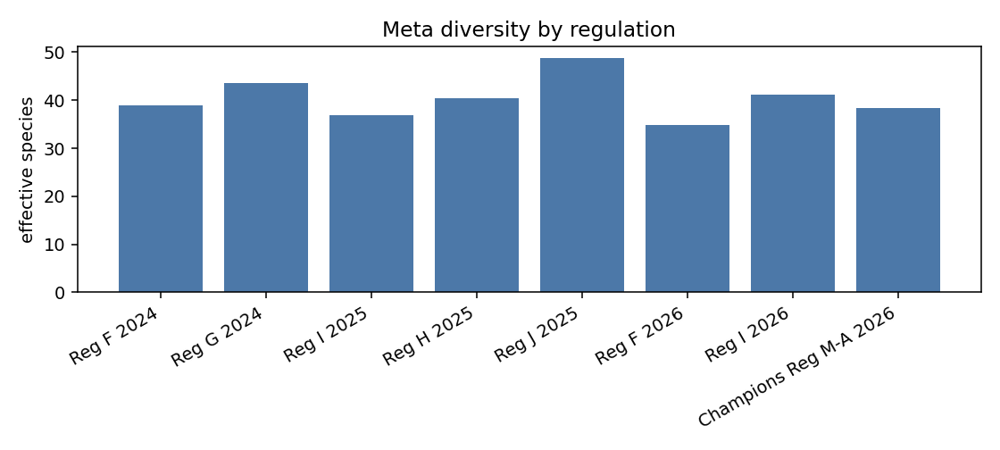
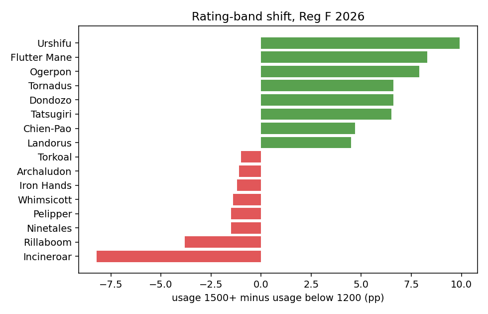
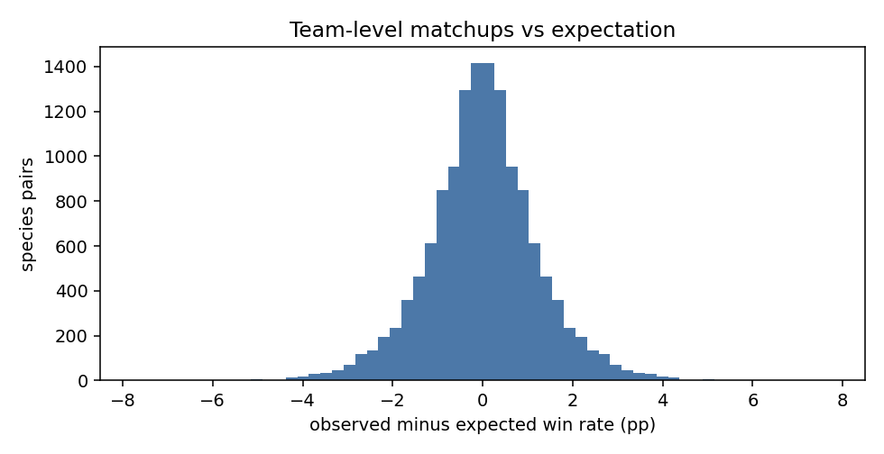

# EDA findings

Generated by `python -m python.analytics.eda_report` from the aggregate tables. Every number below is computed, descriptive and population-bound: completed VGC battles of the regulation shown (see [`METRICS.md`](../METRICS.md)). Nothing here is a causal claim. The narrative lives in [`EDA_INSIGHTS.md`](EDA_INSIGHTS.md).

Left out because they have fewer than 50,000 player-battles: Reg D 2023 (2,534).

## 1. How concentrated is each regulation's meta?

`effective_species` is 1 / sum(p²) over each species' share of team slots: the number of equally used species that would give the same concentration (higher = more diverse).

| regulation | top_species | top1_usage_% | top5_mean_usage_% | species_over_5% | effective_species |
|---|---|---|---|---|---|
| Reg F 2024 | Ogerpon | 40.6 | 33.8 | 25 | 39.0 |
| Reg G 2024 | Incineroar | 38.9 | 30.2 | 26 | 43.5 |
| Reg I 2025 | Calyrex | 48.8 | 33.0 | 29 | 36.9 |
| Reg H 2025 | Incineroar | 37.0 | 31.5 | 28 | 40.4 |
| Reg J 2025 | Calyrex | 38.8 | 27.2 | 28 | 48.7 |
| Reg F 2026 | Urshifu | 42.5 | 35.7 | 27 | 34.9 |
| Reg I 2026 | Calyrex | 46.8 | 30.4 | 28 | 41.1 |
| Champions Reg M-A 2026 | Sneasler | 38.7 | 32.3 | 31 | 38.3 |

## 2. How fast does the meta settle?

Spearman rank correlation of species usage between consecutive months (top 30 species, tail months excluded). Close to 1 means the ranking barely moves.

| regulation | months | mean_rank_corr | min_rank_corr |
|---|---|---|---|
| Reg F 2024 | 5 | 0.889 | 0.811 |
| Reg G 2024 | 5 | 0.945 | 0.836 |
| Reg I 2025 | 5 | 0.919 | 0.851 |
| Reg H 2025 | 4 | 0.964 | 0.952 |
| Reg J 2025 | 5 | 0.973 | 0.949 |
| Reg F 2026 | 5 | 0.959 | 0.937 |
| Reg I 2026 | 4 | 0.967 | 0.959 |
| Champions Reg M-A 2026 | 2 | 0.921 | 0.921 |

## 3. What do strong players pick differently? (Reg F 2026)

Usage among players rated 1500+ minus usage among players below 1200, in percentage points (species with at least 2,000 teams in both bands).

| species | usage_low | usage_high | shift_pp |
|---|---|---|---|
| Incineroar | 39.2 | 30.9 | -8.2 |
| Rillaboom | 21.6 | 17.8 | -3.8 |
| Ninetales | 6.1 | 4.6 | -1.5 |
| Pelipper | 6.1 | 4.6 | -1.5 |
| Whimsicott | 7.5 | 6.2 | -1.4 |
| Iron Hands | 5.4 | 4.3 | -1.2 |
| Archaludon | 6.9 | 5.9 | -1.1 |
| Torkoal | 9.8 | 8.8 | -1.0 |
| Landorus | 20.6 | 25.2 | 4.5 |
| Chien-Pao | 13.4 | 18.1 | 4.7 |
| Tatsugiri | 2.9 | 9.5 | 6.5 |
| Dondozo | 3.9 | 10.4 | 6.6 |
| Tornadus | 21.9 | 28.5 | 6.6 |
| Ogerpon | 36.4 | 44.3 | 7.9 |
| Flutter Mane | 35.1 | 43.4 | 8.3 |
| Urshifu | 40.0 | 50.0 | 9.9 |

## 4. Does popularity predict win rate?

Rank correlation between a species' usage and its win rate minus the regulation baseline (species with at least 2,000 teams). A value near 0 means popular species are not systematically better or worse.

| regulation | species | spearman_usage_vs_win_delta |
|---|---|---|
| Reg F 2024 | 157 | 0.48 |
| Reg G 2024 | 217 | 0.6 |
| Reg I 2025 | 189 | 0.65 |
| Reg H 2025 | 162 | 0.59 |
| Reg J 2025 | 152 | 0.56 |
| Reg F 2026 | 204 | 0.61 |
| Reg I 2026 | 101 | 0.53 |
| Champions Reg M-A 2026 | 79 | -0.07 |

Strong players pick popular species and also win more, so this can be a rating effect. The same correlation inside each rating band (baseline of that band; species with at least 500 teams in a band) removes most of that mixing:

| regulation | all | below_1200 | 1200_1399 | 1400_1499 | 1500_plus |
|---|---|---|---|---|---|
| Reg F 2024 | 0.48 | 0.53 | 0.4 | 0.27 | 0.21 |
| Reg G 2024 | 0.6 | 0.64 | 0.39 | 0.33 | 0.28 |
| Reg I 2025 | 0.65 | 0.63 | 0.56 | 0.26 | 0.21 |
| Reg H 2025 | 0.59 | 0.56 | 0.4 | 0.17 | 0.21 |
| Reg J 2025 | 0.56 | 0.57 | 0.39 | 0.01 | 0.15 |
| Reg F 2026 | 0.61 | 0.54 | 0.59 | 0.37 | 0.37 |
| Reg I 2026 | 0.53 | 0.54 | 0.43 | -0.12 | -0.14 |
| Champions Reg M-A 2026 | -0.07 | -0.04 | -0.23 | 0.11 | 0.2 |

## 5. How predictable is the Tera type?

For species with at least 5,000 Terastallizations: the share taken by their most used Tera type.

| regulation | tera_per_sent_out_% | species_analysed | median_top_type_share_% | share_with_top_type_>=50% |
|---|---|---|---|---|
| Reg F 2024 | 21.4 | 20 | 52.2 | 65.0 |
| Reg G 2024 | 20.6 | 28 | 51.5 | 50.0 |
| Reg I 2025 | 20.7 | 23 | 61.0 | 69.6 |
| Reg H 2025 | 20.9 | 25 | 53.6 | 52.0 |
| Reg J 2025 | 19.6 | 13 | 48.5 | 46.2 |
| Reg F 2026 | 21.2 | 35 | 57.0 | 62.9 |
| Reg I 2026 | 20.0 | 8 | 48.0 | 50.0 |

## 6. Teammates seen together far more than chance (Reg F 2026)

Highest lift among pairs on at least 5,000 teams. Lift is co-occurrence, not synergy.

| species_a | species_b | teams_both | lift |
|---|---|---|---|
| Tyranitar | Excadrill | 12,917 | 33.19 |
| Weezing | Regigigas | 8,576 | 29.12 |
| Dondozo | Tatsugiri | 39,628 | 19.1 |
| Gallade | Hatterene | 5,448 | 14.81 |
| Ninetales | Articuno | 24,910 | 14.55 |
| Lilligant | Walking Wake | 8,737 | 12.2 |
| Maushold | Annihilape | 5,908 | 12.16 |
| Pelipper | Archaludon | 36,686 | 11.18 |
| Ting-Lu | Gouging Fire | 23,089 | 10.49 |
| Torkoal | Lilligant | 21,026 | 9.56 |

## 7. Are there team-level counters?

Distance (percentage points) between the observed win rate of a team with species A against a team with species B and what the two teams' overall win rates predict (pairs with at least 2,000 battles). Small values mean team-level matchups add little beyond general strength.

| regulation | pairs | median_abs_pp | p95_abs_pp | share_abs_z_gt_4_% |
|---|---|---|---|---|
| Reg F 2024 | 1,592 | 0.71 | 2.54 | 2.1 |
| Reg G 2024 | 2,696 | 0.76 | 2.68 | 4.4 |
| Reg I 2025 | 2,446 | 0.67 | 2.38 | 3.4 |
| Reg H 2025 | 1,996 | 0.71 | 2.49 | 3.6 |
| Reg J 2025 | 1,242 | 0.65 | 2.41 | 1.3 |
| Reg F 2026 | 2,390 | 0.81 | 3.01 | 5.5 |
| Reg I 2026 | 786 | 0.57 | 2.27 | 0.3 |
| Champions Reg M-A 2026 | 584 | 0.56 | 1.94 | 0.0 |

